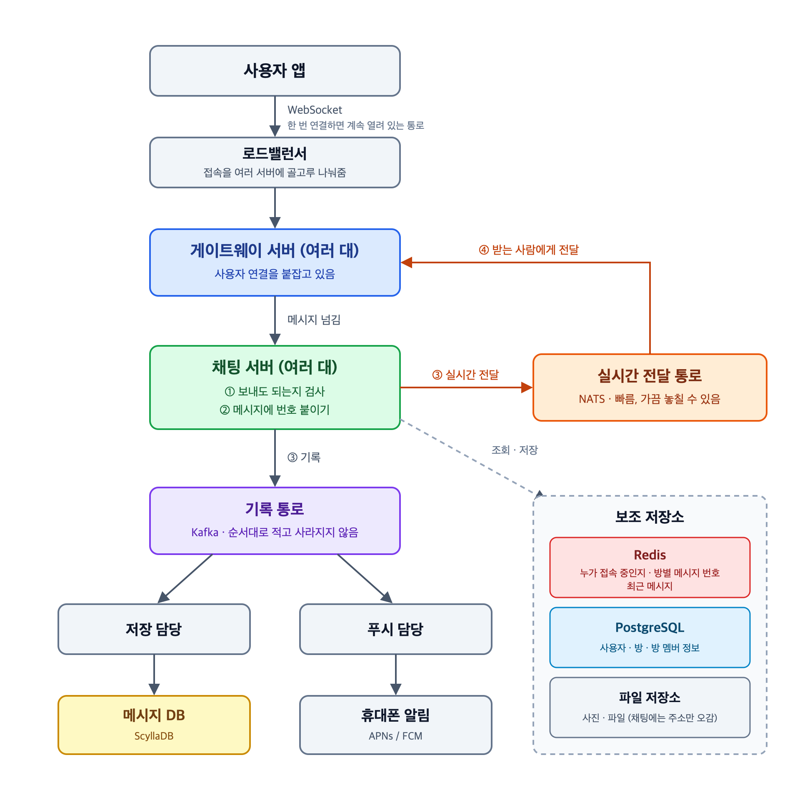

# 대규모 채팅 서버 기본 아키텍처 (쉬운 설명판)

> 초안 (2026-11-16). 요구사항이 아직 정해지지 않아서 아래 "전제"를 깔고 썼다. 전제가 바뀌면 설계도 일부 바뀐다.

## 1. 무엇을 만들려는가

전제는 이렇다.

- 1:1 채팅, 소규모 그룹 채팅, 라이브 방송처럼 수만 명이 한 방에 모이는 채팅을 모두 지원한다.
- 동시에 100만 명이 접속해도 서버를 더 붙이면 버틸 수 있어야 한다.
- 보낸 메시지는 사라지지 않고, 방 안에서는 순서가 뒤바뀌지 않는다.
- 메시지는 보낸 뒤 0.2초 안에 상대에게 도착한다.

## 2. 설계의 세 가지 원칙

**① 연결을 붙잡는 서버와 일을 처리하는 서버를 나눈다.**
사용자와 연결을 계속 유지하는 서버는 재시작하기 어렵다. 그래서 이 서버는 최대한 단순하게 두고, 자주 바뀌는 로직은 다른 서버에 둔다.

**② "지금 바로 전달"과 "DB에 저장"을 따로 처리한다.**
저장을 기다렸다가 전달하면 DB가 느려질 때 채팅 전체가 느려진다. 전달은 전달대로, 저장은 저장대로 간다.

**③ 작은 방과 큰 방은 다르게 다룬다.**
5명 방과 10만 명 방은 문제가 생기는 지점이 전혀 다르다. 같은 방식으로 처리하면 둘 중 하나는 반드시 망가진다.

## 3. 전체 그림



그림 읽는 법:

- 회색 화살표는 메시지가 들어와서 저장되기까지의 길이다.
- 주황색 화살표는 메시지가 받는 사람에게 바로 전달되는 길이다.
- ③이 두 개인 이유: 채팅 서버가 "기록"과 "실시간 전달"을 동시에 내보내기 때문이다.
- 점선은 채팅 서버가 필요할 때 보조 저장소를 조회하거나 저장한다는 뜻이다.

## 4. 각 부분이 하는 일

### 게이트웨이 서버 — 문지기

- 사용자와의 연결을 유지한다. 로그인 확인, 연결이 살아 있는지 확인하는 일만 한다.
- "내 서버에 붙은 사람 중 누가 어느 방에 있는지"를 기억한다.
- 내 서버에 사람이 있는 방의 메시지만 받아 온다.
- **느린 사용자 처리**: 네트워크가 느려서 메시지를 못 받아 가는 사용자가 있으면 메시지가 서버에 쌓인다. 쌓을 수 있는 양에 한도를 두고, 넘치면 연결을 끊는다. 끊긴 사용자는 다시 접속해서 못 받은 메시지를 받아 간다. 한도가 없으면 느린 사용자 몇 명 때문에 서버 메모리가 바닥난다.
- 서버를 교체할 때는 사용자에게 "다른 서버로 다시 접속해 달라"고 조금씩 나눠서 알린 뒤 종료한다.

### 채팅 서버 — 실제 일꾼

메시지를 받으면 순서대로 처리한다.

1. 이 사람이 이 방에 메시지를 보낼 권한이 있는지 확인
2. 너무 빨리 많이 보내고 있지 않은지 확인 (도배 방지)
3. 메시지에 고유 번호와 방 안에서의 순번을 붙임
4. 기록 통로와 실시간 전달 통로로 내보냄
5. 보낸 사람에게 "잘 받았다"고 응답

방 만들기, 입장, 퇴장, 지난 메시지 조회도 여기서 처리한다. 이 서버는 아무것도 기억하지 않으므로 필요한 만큼 늘리고 줄일 수 있다.

### 실시간 전달 통로 (NATS) — 방송 스피커

- 게이트웨이 서버들 사이에서 메시지를 실어 나른다.
- 빠른 대신 가끔 메시지를 놓칠 수 있다. 놓친 메시지는 뒤에 설명하는 "순번 확인" 방식으로 복구한다.

### 기록 통로 (Kafka) — 장부

- 모든 메시지를 순서대로 적어 두는 곳. 한번 적히면 사라지지 않는다.
- 저장 담당, 푸시 담당 등이 각자 속도에 맞춰 이 장부를 읽어 간다.
- 같은 방의 메시지는 항상 같은 줄에 순서대로 적힌다.

### 저장소

| 무엇을 저장 | 어디에 | 이유 |
|---|---|---|
| 메시지 | ScyllaDB | 쓰는 양이 엄청 많고, 서버를 늘려서 확장하기 쉽다 |
| 사용자·방·멤버 | PostgreSQL | 양이 적고, 정확성이 중요하다 |
| 접속 상태·카운터 | Redis | 빠르고, 일정 시간 뒤 자동으로 지워진다 |

## 5. 메시지가 오가는 과정

### 보낼 때

1. 앱이 메시지에 임시 번호를 붙여서 보낸다.
2. 게이트웨이가 채팅 서버로 넘긴다.
3. 채팅 서버가 검사하고 정식 번호와 순번을 붙인다.
4. **장부(Kafka)에 적힌 것을 확인한 뒤** 보낸 사람에게 "전송 완료"를 알린다. 이 순서를 지켜야 "전송 완료라고 떴는데 메시지가 없어지는" 사고가 안 난다.
5. 실시간 전달 통로를 통해 같은 방 사람들에게 전달된다.
6. 저장 담당이 장부를 읽어 DB에 모아서 저장한다.

**같은 메시지가 두 번 보내지는 문제**: 네트워크가 끊겨서 앱이 같은 메시지를 다시 보낼 수 있다. 서버는 임시 번호를 보고 "이미 받은 메시지"임을 알아채서 중복으로 만들지 않는다.

### 연결이 끊겼다 다시 붙을 때

- 방 안의 메시지에는 1, 2, 3… 순번이 붙어 있다.
- 앱은 "나는 57번까지 받았다"를 기억한다.
- 다시 접속하면 서버에 "57번 이후 것을 달라"고 요청한다.
- 받는 도중 58번 다음에 60번이 오면, 앱이 59번이 빠진 것을 알아채고 따로 요청한다.

이 방식 덕분에 중간 통로에서 메시지를 가끔 놓쳐도 최종적으로는 빠짐없이 받게 된다.

### 상대가 접속해 있지 않을 때

- 푸시 담당이 장부를 읽다가 받는 사람이 접속 중이 아니면 휴대폰 알림을 보낸다.
- 라이브 방송형 대형 방은 알림을 보내지 않는다.

## 6. 작은 방과 큰 방의 차이

| | 작은 방 (1:1, 그룹) | 큰 방 (라이브) |
|---|---|---|
| 멤버 | DB에 저장된 고정 멤버 | 지금 접속해 있는 사람이 전부 |
| 전달 | 모든 메시지를 빠짐없이 | 최선을 다하되, 몰리면 일부 생략 |
| 읽음 표시 | 지원 | 지원 안 함 |
| 접속자 표시 | 누가 접속 중인지 표시 | 대략적인 인원 수만 표시 |
| 지난 메시지 | 계속 보관 | 최근 것만 보관 |

큰 방에서 꼭 챙길 것:

- **메시지가 너무 많이 몰릴 때**: 1초에 수천 개가 올라오면 어차피 사람이 읽을 수 없고 앱도 버벅인다. 화면에 내보내는 속도에 상한을 두고 넘치는 것은 일부만 골라서 보낸다. 운영자 메시지는 반드시 보낸다.
- **묶어서 보내기**: 메시지를 하나씩 보내지 않고 0.05~0.1초 단위로 모아서 한 번에 보낸다. 서버 부담이 크게 줄어든다.
- **입장/퇴장을 일일이 알리지 않는다.** 10만 명 방에서 "누가 들어왔습니다"를 전부 뿌리면 그것만으로 서버가 죽는다. 인원 수만 주기적으로 알려 준다.
- **한 번만 포장한다.** 같은 메시지를 10만 명에게 보낼 때 10만 번 변환하지 않고, 한 번 변환한 것을 그대로 돌려 쓴다.

## 7. 데이터 구조

### 메시지 번호 두 가지

- **고유 번호(`message_id`)**: 전체 서비스에서 겹치지 않는 번호. 메시지를 가리킬 때 쓴다.
- **순번(`seq`)**: 방 안에서 1씩 늘어나는 번호. 순서를 정하고 빠진 메시지를 찾을 때 쓴다.
- 사용자 휴대폰의 시계는 믿지 않는다. 시계가 틀린 기기가 많아서 순서가 꼬인다.

### 메시지 테이블 (ScyllaDB)

```sql
CREATE TABLE messages (
    room_id    bigint,     -- 어느 방
    bucket     int,        -- 순번 구간(10만 개 단위). 한 덩어리가 너무 커지지 않게 나눔
    seq        bigint,     -- 방 안 순번
    message_id bigint,     -- 고유 번호
    sender_id  bigint,     -- 보낸 사람
    type       tinyint,    -- 글, 사진, 시스템 알림 등
    body       text,       -- 내용
    created_at timestamp,
    PRIMARY KEY ((room_id, bucket), seq)
) WITH CLUSTERING ORDER BY (seq DESC);
```

### 사용자·방 정보 (PostgreSQL)

- `users` 사용자, `rooms` 방, `room_members` 방 멤버
- **읽음 처리**: 메시지마다 "읽음" 표시를 하지 않는다. 멤버마다 "몇 번까지 읽었는지" 숫자 하나만 저장한다. 안 읽은 개수 = 방의 최신 순번 − 내가 읽은 순번.

### Redis에 두는 것

| 내용 | 유지 시간 |
|---|---|
| 사용자가 어느 서버에 접속해 있는지 | 짧게 (접속이 끊기면 자동으로 사라짐) |
| 방별 현재 순번 | 계속 |
| 방별 최근 메시지 | 방 종류에 따라 |
| 도배 방지용 횟수 | 몇 초~몇 분 |

## 8. 앱과 서버가 주고받는 형식

- 통로는 WebSocket. 내용은 처음엔 JSON으로 시작하고, 나중에 더 가벼운 형식(Protobuf)으로 바꿀 수 있게 버전 표시를 넣어 둔다.
- 주고받는 메시지 종류: 로그인, 방 입장, 방 퇴장, 보내기, 전송 완료 응답, 메시지 수신, 빠진 메시지 요청, 연결 확인, 재접속 요청, 오류.
- **재접속은 각자 조금씩 다른 시간만큼 기다렸다가 한다.** 서버 한 대가 죽으면 수십만 명이 동시에 재접속을 시도하는데, 이걸 한꺼번에 받으면 다른 서버까지 연달아 죽는다.

## 9. 운영할 때 챙길 것

- **도배 방지**: 사용자별, 방별, IP별로 보낼 수 있는 횟수를 제한한다.
- **일부가 고장 나도 전체가 죽지 않게**: DB가 고장 나면 새 메시지 전송만 실패하고, 이미 접속한 사람들의 연결은 유지한다. Redis가 고장 나면 접속 표시는 틀릴 수 있어도 메시지는 계속 전달한다.
- **계속 지켜볼 숫자**: 서버별 접속자 수, 메시지 도착 시간, 버려진 메시지 수, 재접속 비율, 저장이 밀린 정도.
- **미리 해 볼 시험 세 가지**: ① 100만 명이 가만히 접속만 해 있을 때 ② 한 방에 10만 명이 있을 때 ③ 수십만 명이 한꺼번에 재접속할 때.
- **여러 지역 서비스**: 처음엔 한 지역만. 필요해지면 그때 확장한다.

## 10. 만드는 순서

| 단계 | 할 일 | 구성 |
|---|---|---|
| 1. 최소 버전 | 서버 한 대로 전체 흐름이 돌아가는지 확인. 앱과 서버의 통신 규칙, 순번 방식을 확정 | 서버 1개 + PostgreSQL + Redis |
| 2. 서버 늘리기 | 게이트웨이를 여러 대로. 서버끼리 메시지 넘기기 | 게이트웨이/채팅 서버 분리 + NATS |
| 3. 저장 분리 | 저장과 푸시를 뒤에서 따로 처리 | Kafka + ScyllaDB 추가 |
| 4. 큰 방 대응 | 일부 생략, 묶어 보내기, 느린 사용자 처리, 부하 시험 | 위 구성 + 조정 |

**1단계에서 통신 규칙과 순번 방식을 제대로 정하는 것이 가장 중요하다.** 이것만 잘 잡으면 뒤 단계는 서버 내부만 바꾸면 된다. 나중에 바꾸려면 이미 배포된 앱까지 전부 고쳐야 한다.

## 11. 기술 선택 제안

| 영역 | 제안 | 다른 선택지 |
|---|---|---|
| 서버 언어 | Rust | Go, Elixir |
| 서버끼리 통신 | gRPC | — |
| 실시간 전달 통로 | NATS | Redis Pub/Sub |
| 기록 통로 | Kafka | NATS JetStream, Redpanda |
| 메시지 DB | ScyllaDB | Cassandra, 규모가 작으면 PostgreSQL |
| 배포 | Kubernetes | — |

서버 언어는 정해진 것이 없어 Rust로 적었다. 팀이 익숙한 언어가 있으면 그쪽이 낫다.

## 12. 먼저 정해야 할 것

- 목표 규모: 동시 접속자 수, 한 방 최대 인원, 1초당 메시지 수
- 라이브 방송형 큰 방이 주력인지, 메신저형이 주력인지
- 메시지를 얼마나 오래 보관할지, 검색이 필요한지
- 읽음 표시, 입력 중 표시, 멘션, 답글, 수정/삭제 중 무엇을 지원할지
- 금칙어, 신고, 강퇴, 도배 제한을 어느 수준까지 할지
- 서버도 내용을 볼 수 없는 암호화(종단간 암호화)가 필요한지. 필요하면 서버에서 검색과 금칙어 검사를 할 수 없어 설계가 크게 바뀐다.
- 서버 언어와 인프라(클라우드인지 자체 서버인지) 제약

## 용어 풀이

| 용어 | 뜻 |
|---|---|
| WebSocket | 앱과 서버가 한 번 연결하면 끊지 않고 계속 주고받는 통신 방식 |
| 게이트웨이 | 사용자 연결을 직접 붙잡고 있는 서버 |
| 팬아웃 | 메시지 하나를 여러 사람에게 뿌리는 일 |
| NATS | 서버끼리 메시지를 빠르게 주고받게 해 주는 도구 |
| Kafka | 들어온 데이터를 순서대로 안전하게 쌓아 두는 도구 |
| Redis | 메모리에 올려 두고 쓰는 아주 빠른 저장소 |
| ScyllaDB | 대량의 데이터를 여러 서버에 나눠 저장하는 DB |
| gRPC | 서버끼리 서로의 기능을 호출하는 방식 |
| 푸시 | 앱을 켜지 않아도 휴대폰에 뜨는 알림 |
